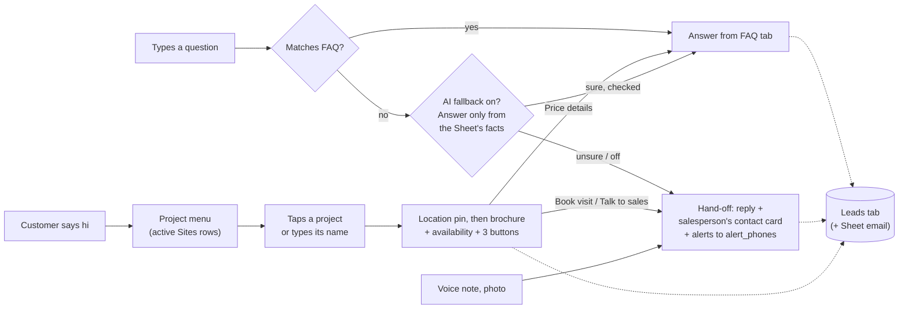
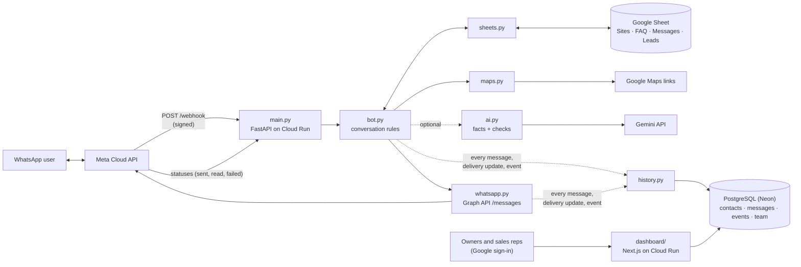

# WhatsApp lead bot

A WhatsApp bot for a real-estate builder. It shows customers the projects that have flats for sale, sends each project's location, brochure and current availability, answers common questions (from the Sheet's FAQ keywords, with an optional Gemini AI fallback that uses only the Sheet's content), and hands everything else to the right sales team. A Google Sheet is the control panel: projects, FAQs and wording are edited there, and every enquiry is logged there. Optionally, every message is also saved to PostgreSQL, and a web dashboard ([`dashboard/`](dashboard/README.md)) lets owners and sales reps read each lead's full conversation.

- **Stack:** Python 3.12, FastAPI, httpx, gspread, psycopg; WhatsApp Cloud API (Graph API v26.0); Google Cloud Run (`asia-south1`). Dashboard: Next.js 16, PostgreSQL on Neon

## How a conversation flows



## Architecture



One request per incoming message. Cloud Run scales to zero when idle and wakes in a few seconds.

## Code map

| File | Responsibility |
| --- | --- |
| `main.py` | FastAPI app. `GET /webhook` answers Meta's verification challenge; `POST /webhook` checks `X-Hub-Signature-256`, hands the payload to the bot in a thread, and always returns 200. Builds the `Bot` lazily from environment variables. `GET /` is a health check. |
| `bot.py` | Conversation logic: routing, menu, project pack, FAQ matching, hand-off, sales alerts. `DEFAULT_MESSAGES` holds every customer-facing string; the Messages tab overrides them. |
| `whatsapp.py` | Builds and sends Cloud API messages (text, list, reply buttons with a document or text header, location, contact card, template, read receipt). Brochures are downloaded by the bot (with a separate client, so the host never sees the WhatsApp token), checked to be a PDF and uploaded to WhatsApp's media store as `application/pdf`; the media id is reused for 6 hours. If that fails, the brochure is sent as a link. Enforces WhatsApp's length limits with `clip()`. Also `e164()` and `direct_download_url()` for Google Drive links. |
| `sheets.py` | `SheetStore`: reads Sites, FAQ and Messages (cached 60 s), appends to Leads, looks up a customer's last project. Pure `parse_*` functions turn rows into dicts. |
| `ai.py` | Optional AI fallback. `build_facts()` turns the active Sites rows and non-`SALES` FAQ rows into numbered facts; `Gemini` sends them with the question to Google's Gemini API (REST, structured JSON); `check_reply()` refuses anything unsafe before a customer sees it. |
| `history.py` | `History`: saves incoming messages, sent messages (via `WhatsApp.on_sent`), Meta's delivery updates and lead events to PostgreSQL for the dashboard. Every write is wrapped so a database problem is logged and never stops a reply. `NoHistory` when `DATABASE_URL` is empty. |
| `maps.py` | `MapsResolver`: reads coordinates from a Google Maps link, opening short links (`maps.app.goo.gl`) to find them. Caches results; retries failures after 10 minutes. |
| `tests/test_bot.py` | 54 tests with fakes for WhatsApp, the Sheet, Maps, the AI and the database pool, plus payload-shape tests against `httpx.MockTransport` and FastAPI `TestClient` tests. |
| `tests/test_history_postgres.py` | `History` against a real PostgreSQL with the dashboard's schema; skipped unless `TEST_DATABASE_URL` is set. |
| `tools/make_sheet_template.py` | Generates `sheet-template/WhatsApp-Bot-Sheet-Template.xlsx` (Read me, Sites, FAQ, Messages, Leads). |
| `tools/try_ai.py` | Checks a Gemini API key and model against sample projects and prints what the bot would do. Run it before switching the AI on. |
| `tools/demo_conversations.py` | Fills a local database with sample conversations made by the real bot code, for trying the dashboard. |
| `dashboard/` | The lead dashboard (Next.js). See [`dashboard/README.md`](dashboard/README.md). |

## Conversation rules (`bot.py`)

**Interactive replies** carry an id of the form `action:site_id`:

| id | Result |
| --- | --- |
| `site:<id>` | Project pack: location (pin, or text with address/link), then the brochure-header message with availability and three buttons |
| `visit:<id>` | Hand-off with the `visit_reply` text; event `visit_request` |
| `price:<id>` | FAQ answer for keyword `price` on that project; hand-off with event `price_request` if there's no such row or it's a `SALES` row |
| `sales:<id>` | Hand-off; event `sales_request` |
| anything else, or an inactive project | Menu again (customers may tap menus sent days ago) |

**Text** is normalised (lowercase, punctuation removed) and routed in this order:

1. If it names a project (`name` or `aliases`), that becomes the current project.
2. **FAQ match:** a `SALES` row (answer is just `SALES`) wins whenever one of its keywords appears, and goes to hand-off (step 5). Otherwise a row wins with the most whole-word keyword hits; on a tie, a project-specific row beats a general one. Rows for other projects are ignored.
3. Else, if it named a project → project pack.
4. Else, if it's a greeting (`hi`, `hello`, `menu`, `namaste`, …) → menu.
5. Else, if the AI fallback is on (`GEMINI_API_KEY`), the AI may answer from the Sheet's facts (event `ai_answered`); see below.
6. Else, or on a `SALES` row → hand-off. If the customer has no current project, the menu follows.

**AI fallback** (`ai.py`, off unless `GEMINI_API_KEY` is set). Meta allows business-specific AI only, so:

- It runs only when everything above missed. FAQ matches, `SALES` topics, greetings and project names never reach it.
- The model gets numbered facts (`P1…` per active project: name, aliases, tagline, availability, address, salesperson; `F1…` per FAQ row except `SALES` rows and inactive projects), the `SALES` keywords as topics it must hand off, the current project and the question. Never the customer's name or number.
- It must reply in JSON: `handoff`, `answer`, `sources`. The bot sends the answer only if `handoff` is false, every source id exists, every number in the answer appears in the cited facts, and it's at most 1,000 characters. Anything else (including API errors and timeouts) is a normal hand-off.
- At most 10 AI answers per customer per hour (`AI_LIMIT_PER_HOUR`), then a person takes over.
- It answers in the customer's language (English, Hindi, Marathi or a mix). The answer gets the `faq_footer` line.

**Other message types** (voice, image, location…) → `non_text` reply plus hand-off.

**Current project** per customer is kept in memory, falling back to the newest Leads row with a `site_id` (survives restarts and multiple instances).

**Hand-off** sends the reply text and one contact card (the project's `sales_name`/`sales_phone`, else the defaults), logs to Leads, then calls `alert()`.

**Alerts** (only when `SALES_ALERT_TEMPLATE` is set): the template goes to every number in the project's `alert_phones`, else its `sales_phone`, else `DEFAULT_ALERT_PHONES`, else `DEFAULT_SALES_PHONE`. Parameters: `{{1}}` customer name, `{{2}}` customer number, `{{3}}` project, `{{4}}` what they asked. The same customer, project and event alert at most once per 6 hours. With `SALES_ALERT_ON=all`, opening a project also alerts.

**Messages sent:** menu 1; project pack 2; FAQ or AI answer 1; hand-off 2 (+ alerts, which are template messages).

## Google Sheet (data model)

Tab names and header names are the contract between the code and the owner; columns are read by header name, except Leads (see below).

**Sites**, one row per project:

| Column | Type | Notes |
| --- | --- | --- |
| `site_id` | text | Unique, stable; used in button ids and Leads |
| `name` | text | Menu row title (clipped to 24 chars) |
| `aliases` | comma list | Other names customers type |
| `active` | Yes/No | Only Yes rows load; menu shows the first 10 |
| `tagline` | text | Menu row description (≤ 72) |
| `brochure_url` | URL | Drive share link (converted to direct download) or a direct PDF URL. The bot uploads the PDF to WhatsApp itself (sent as a link, Drive's `application/octet-stream` made phones show a `.bin` file) |
| `brochure_filename` | text | Defaults to `<name> brochure.pdf`; `.pdf` is added if missing |
| `availability` | text | Inserted via `{availability}` in `site_details` |
| `maps_link` | URL | Google Maps link → pin via `maps.py` |
| `latitude`, `longitude` | number | Optional; override `maps_link` |
| `address` | text | Shown with the pin |
| `sales_name`, `sales_phone` | text | Contact card for this project |
| `alert_phones` | comma list | Alert recipients; separators `, ; / newline` |

**FAQ:** `keywords` (comma list, whole-word, case-insensitive), `answer` (supports placeholders; just `SALES`, any case, means hand off instead of answering; parsed as `to_sales`), `site_id` (blank = all projects).

**Messages:** `key`, `text` (`used_when` is a note for the owner). Keys: `welcome`, `menu_button`, `menu_footer`, `site_details`, `btn_visit`, `btn_price`, `btn_sales`, `visit_reply`, `handoff`, `faq_footer`, `non_text`, `no_sites`. Placeholders: `{name} {company} {site_name} {availability} {sales_name} {sales_phone}`. Unknown placeholders render empty; stray braces fall back to the raw text.

**Leads** (written by the bot with `append_row(..., value_input_option="RAW")`, so customer text can't inject formulas): `timestamp` (IST), `phone`, `name`, `site_id`, `site_name`, `event`, `detail`. Columns are **positional**; `last_site_id()` reads index 1 (phone) and 3 (site_id). Add new columns only at the end. Events: `menu_shown`, `site_selected`, `faq_answered`, `ai_answered`, `price_request`, `visit_request`, `sales_request`, `handoff`, `non_text`.

## Conversation log (PostgreSQL)

With `DATABASE_URL` set, the bot saves everything the dashboard shows. The tables are defined in [`dashboard/db/schema.sql`](dashboard/db/schema.sql), which the dashboard applies on first use. Deploy the dashboard before setting the bot's `DATABASE_URL`.

| Table | Written by | Holds |
| --- | --- | --- |
| `contacts` | bot | One row per customer: `phone` (Meta's digits, e.g. `919812345678`), WhatsApp profile `name`, `first_seen`, `last_seen` (latest customer message) |
| `messages` | bot | Every message in and out: `direction`, Meta's `kind`, readable `body`, the exact `payload`, `wa_message_id`, `status` (`received`; `sent` → `delivered` → `read`, or `failed` with `error`) |
| `events` | bot | The same lead events as the Leads tab, plus `sales_alerted` (who got the WhatsApp alert) |
| `team` | dashboard | Who may sign in: `email`, `name`, `role` (`owner`/`sales`), `site_ids` |

- Sales alerts (templates to salespeople) aren't stored as messages; the `sales_alerted` event records them on the customer's conversation.
- Meta's `statuses` webhooks update `messages.status`. A status only moves forward, because Meta can deliver them out of order.
- `messages` and `events` share one id sequence, so a conversation sorts in exactly the order things happened.
- Writes happen while the webhook is handled, and each one is guarded: if the database is down, the bot still replies and logs `Could not save to the database`.
- Voice notes, photos and files are stored as their Meta payload only (no media download), so the dashboard can't show or play them.

## Configuration (environment variables)

Set them in `env.yaml` (copied from `env.yaml.example`, gitignored) and deploy with `--env-vars-file`.

| Variable | Required | Meaning |
| --- | --- | --- |
| `WA_TOKEN` | yes | Permanent system-user token |
| `WA_PHONE_NUMBER_ID` | yes | The bot number's Phone number ID |
| `WA_VERIFY_TOKEN` | yes | Phrase echoed during webhook verification |
| `WA_APP_SECRET` | strongly recommended | Enables signature checking of webhooks |
| `GRAPH_API_VERSION` | no | Default `v26.0` |
| `SHEET_ID` | yes | Google Sheet id |
| `GOOGLE_CREDENTIALS_JSON` | no | Service-account JSON for local runs; on Cloud Run the service identity is used |
| `COMPANY_NAME` | no | `{company}` and the menu header |
| `DEFAULT_SALES_NAME`, `DEFAULT_SALES_PHONE` | no | Fallback contact card |
| `SALES_ALERT_TEMPLATE` | no | Approved template name; empty disables alerts |
| `SALES_ALERT_LANGUAGE` | no | Template language code, default `en` |
| `SALES_ALERT_ON` | no | `handoffs` (default) or `all` |
| `DEFAULT_ALERT_PHONES` | no | Alert recipients when no project is known |
| `GEMINI_API_KEY` | no | Turns on the AI fallback (Google AI Studio key). Empty: keyword FAQ only |
| `GEMINI_MODEL` | no | Default `gemini-3.5-flash-lite`; e.g. `gemini-3.8-flash` for a stronger model |
| `DATABASE_URL` | no | PostgreSQL connection string (Neon). Empty: conversations aren't saved and the dashboard stays empty |

## Reliability and security

- Meta retries non-200 webhook responses for up to 7 days, so `POST /webhook` always returns 200 and the bot dedupes by message id (last 5,000).
- Signature check (`X-Hub-Signature-256`, HMAC-SHA256 with the app secret) when `WA_APP_SECRET` is set.
- Sheet tabs are cached 60 s; on a read error the last good copy is used.
- A missing Sheet or bad credentials don't stop the server from starting, so Meta can still verify the webhook. The bot is built on the first message, and errors are logged.
- Secrets live only in `env.yaml` (excluded by `.gitignore` and `.gcloudignore`).

## Run the tests

```bash
python3 -m venv .venv && . .venv/bin/activate
pip install -r requirements.txt -r requirements-dev.txt
python -m pytest -q
```

The database test needs a PostgreSQL. No Docker needed; the dashboard's local one works:

```bash
cd dashboard && npm install && npx pglite-server --port=54329 --max-connections=8    # leave running
TEST_DATABASE_URL=postgresql://postgres@127.0.0.1:54329/postgres python -m pytest -q tests/test_history_postgres.py
```

Dashboard tests: `cd dashboard && npm test` (see [`dashboard/README.md`](dashboard/README.md)).

## Run locally

Meta needs a public HTTPS URL, so local runs are mainly for debugging. Use a tunnel (for example ngrok or cloudflared) and set the webhook to the tunnel URL temporarily.

Set the same variables as in `env.yaml` in your shell (or in a VS Code launch configuration), then:

```bash
uvicorn main:app --port 8080
```

Locally there's no Cloud Run identity, so set `GOOGLE_CREDENTIALS_JSON` or run `gcloud auth application-default login --scopes=https://www.googleapis.com/auth/spreadsheets,https://www.googleapis.com/auth/cloud-platform`.

## Deploy

```bash
gcloud run deploy whatsapp-bot --source . --region asia-south1 --allow-unauthenticated \
  --service-account "whatsapp-bot@$(gcloud config get-value project).iam.gserviceaccount.com" \
  --env-vars-file env.yaml
```

The `Dockerfile` copies only the top-level `*.py` files; `.gcloudignore` keeps docs, tests, the dashboard and secrets out of the upload. The dashboard is a separate Cloud Run service (`lead-dashboard`, deployed with `--source dashboard`).

## Extending

- **New Sites/FAQ column:** read it in `sheets.parse_sites`/`parse_faq`, use it in `bot.py`, add it to `tools/make_sheet_template.py` and regenerate, document it here, add a test. Existing Google Sheets need the column added by hand.
- **New customer-facing text:** add a key to `DEFAULT_MESSAGES` and to `used_when` in the template generator; never hard-code wording.
- **New button:** reply-button messages allow 3 buttons. Adding a fourth action means a list message or a second step. Add a handler in `Bot.on_choice` keyed by a new `action:` prefix.
- **AI answers:** Meta bans general-purpose AI assistants on the Business API (since 15 Jan 2026). Keep the AI fallback business-specific: facts only from the Sheet, `check_reply()` before sending, hand-off when unsure. To try another provider, give it the same `answer(question, facts, topics, project, company)` method and pass it as `Bot(ai=...)`.

## Known limitations

- WhatsApp lists show at most 10 projects.
- FAQ matching is whole-word keywords: no typo tolerance, no synonyms beyond what the Sheet lists. The AI fallback covers some of this when it's on.
- The AI can only be as right as the Sheet: it may still word a correct fact awkwardly. Owners should glance at `ai_answered` rows and fix or add FAQ rows.
- The Leads lookup reads the whole tab: fine for tens of thousands of rows; archive old rows yearly.
- The dashboard can't show or play voice notes, photos or files, only that one arrived (and its caption).
- The dashboard shows the bot number's chats only, not what sales staff send from their own phones.
